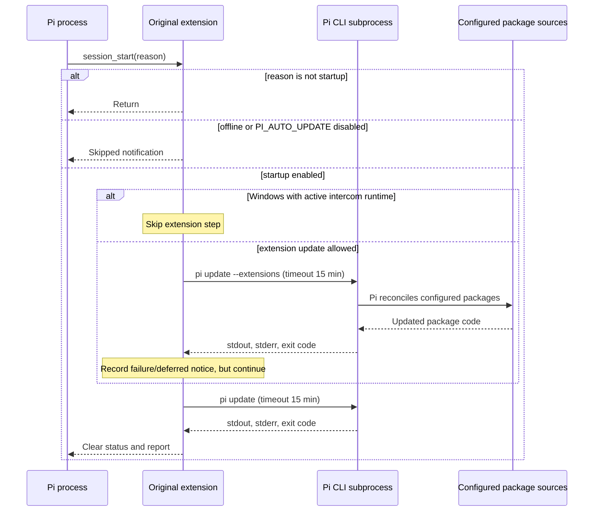

# Execution and trust boundaries

See the [README](../README.md) for setup, model settings, and supported scope.

## Original updater, exactly

Source: upstream `e49977a698644bd231bcf45e782f006acc65028e`,
`extensions/auto-update.ts`.



The original `inFlight` promise coalesces concurrent requests inside its runtime.
Its manual command goes directly to the update loop, bypassing startup skip checks.
It never asks an AI to assess either command or its downloaded code.

## Security gate: one supported target

Automatic startup checks are launched without awaiting them, so Pi is usable
immediately. They do not write footer status or notifications, including for
skips, blocked updates, or failures. Reports and session entries retain results;
failures before a report is available are saved as `auto-update-security-error`
session entries. `/auto-update-now` joins an active check or starts one and shows
its result or failure. Shutdown cancels active work and waits for cleanup.

```mermaid
sequenceDiagram
    participant Host as Pi / extension
    participant Disk as Installed tree
    participant Stage as Private staging directory
    participant Scan as npm advisory service
    participant Model as Tool-less reviewer
    Host->>Disk: Read personal settings; acquire lock; hash baseline
    Host->>Stage: Stage npm tree or clean GitHub clone
    Note over Stage: No candidate import, build, test or lifecycle execution
    Host->>Stage: Validate integrity-pinned registry lock; npm ci with scripts disabled
    Host->>Stage: Match actual dependency identities to lock
    Host->>Scan: npm audit of staged production lock
    Scan-->>Host: Complete zero-finding result, or block
    Host->>Stage: Freeze candidate separately; hash files and Git metadata
    Host->>Model: New conversation: complete before/after text and manifests
    Note over Model: No tools or parent history; package contents are untrusted data
    Model-->>Host: Strict digest-bound complete approve/block verdict
    alt any finding, incomplete check, error, or unsupported input
        Host->>Stage: Delete candidate; keep baseline
    else complete approval, zero findings
        Host->>Disk: Rehash baseline and recheck settings
        Host->>Stage: Rehash exact frozen artifact
        Host->>Disk: Journal paths; rename baseline to backup
        Host->>Stage: Rename frozen artifact to installed location
        Note over Host,Disk: No re-resolution/download after approval
        Host-->>Host: Persist report (manual command also advises restart)
    end
```

For a Git target with no runtime dependencies, the install/audit steps are
unnecessary; all changed source/manifests still pass the reviewer.

The candidate digest covers installed file paths, file modes, symlink targets,
and file contents (including dependencies). Freezing preserves symlink targets
verbatim, so normal relative npm `.bin` links stay inside the frozen/promoted tree
and retain the candidate digest. Absolute links, relative escapes, and escaping
link chains remain blocked; changing a frozen link invalidates approval.
Git's own generated metadata is
excluded from the model's source diff, but included in the final anti-tampering
check. Git hooks are disabled in commands and in the promoted clone.
Nested `.git` directories inside packages are not omitted from source review.

## Bounded review protocol

A small update uses one complete review. Larger updates are split into at most
32 source batches plus one final integration review. Every request is at most
180,000 serialized UTF-8 bytes, further reduced for the selected model context.
The overall review deadline is 15 minutes; each model request also retains its
three-minute timeout. Excessive volume blocks before inference rather than
spending unbounded quota.

Every changed before/after text and candidate manifest is included. Large files
are split with explicit offsets, total lengths, file identities, modes and hashes;
UTF-16 surrogate pairs are never split. Local verification reconstructs every
required stream exactly and rejects missing/duplicate/overlapping/reordered or
altered parts. Unchanged candidate manifests are included once as context.

Source packets carry the baseline/candidate-tree digests, whole-plan digest,
global change inventory and their own file descriptors. Verified prefix/suffix
change windows and unchanged-part flags orient cold batch reviewers without
misrepresenting identical context as a new behavior change. The verdict `candidate`
field binds the SHA-256 of that exact packet. It is NOT a reusable tree-only
approval: an approval for batch 1 cannot approve batch 2 or the final review.
Reports keep the artifact digest in `result.candidate`, and packet bindings,
byte counts, verdicts and verified coverage in `result.review`.

Every source batch must return complete approval with zero findings. The final
integration reviewer receives the entire changed-file inventory, exact bounded
changed-region source excerpts, and security/compatibility evidence from every
approved batch. It checks cross-file
interactions and must block if evidence is insufficient. This final pass uses
model-produced evidence, not a second full-source context: it reduces context
pressure but does not eliminate model false negatives or prompt injection.
Evidence is never silently truncated to fit a final request.

No source batch alone authorizes installation. Any finding, incomplete response,
model/scan error, cancellation, binding mismatch, failed final review, or file
mutation blocks promotion. Final tree and settings checks still protect the
exact frozen artifact. Every target is independent; a blocked target does not
grant approval for another.

## Snapshot resource limits

Snapshots stream-hash opaque files, including large unchanged native artifacts,
without retaining them as model text. Scans are capped at 1 GiB per tree and
256 MiB per file. UTF-8 capture is capped at 8 MiB per file and 128 MiB per
snapshot. An unchanged opaque file is verified by its full SHA-256; any changed
opaque/binary or uncaptured oversized text still requires manual review. These
resource bounds prevent raising the model limit or silently ignoring artifacts.

## Limits

- An LLM can miss or be misled about a vulnerability. Strict JSON is not a
  semantic security guarantee.
- Advisory services cover reported dependencies, not all vulnerabilities in
  the extension's own code. Code review covers supplied changes, not all
  possible behavior or all unchanged code.
- Scripts disabled during staging may leave build-dependent packages unusable;
  these need manual handling, never an automatic unreviewed build.
- Same-user concurrent writers and process crashes are not an OS isolation
  boundary. The two-rename promotion has a crash window, with journal/backups
  for manual recovery.
- Pi core updates and project packages are intentionally deferred. Wrapping a
  later `pi update` would allow unreviewed bytes to be installed, so the security
  gate never does that.
